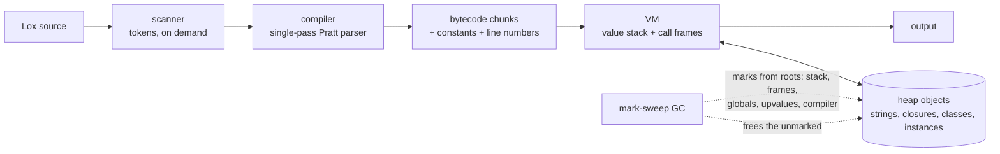

<div align="center">

# clox

**A bytecode virtual machine for the Lox language, written in C from scratch: a single-pass compiler, a stack-based VM, closures, classes and a mark-sweep garbage collector. It passes all 246 of the book's official tests and runs in your browser via WebAssembly.**

[](https://github.com/samadarsh/clox/actions/workflows/ci.yml)


[](LICENSE)

### [▶ Try it in your browser](https://samadarsh.github.io/clox/)

[Features](#features) · [Quick start](#quick-start) · [How it works](#how-it-works) · [Benchmarks](#benchmarks) · [Design decisions](#design-decisions) · [Testing](#how-its-tested)


| 246 / 246 | 98 + 535 | 0 | ~2,600 |
|:---:|:---:|:---:|:---:|
| of the book's official tests pass | our own `.lox` tests + C unit-test checks | memory errors under ASan, UBSan and a GC that runs on every allocation | lines of C, no dependencies |

</div>

## Contents

- [Features](#features)
- [Quick start](#quick-start)
- [Playground](#playground)
- [How it works](#how-it-works)
- [Benchmarks](#benchmarks)
- [Design decisions](#design-decisions)
- [How it's tested](#how-its-tested)
- [Differences from the book](#differences-from-the-book)
- [What I learned](#what-i-learned)
- [Roadmap](#roadmap)

## Features

- **The whole Lox language:** numbers, strings, booleans, `nil`, variables and block scope, `if`/`while`/`for`, `and`/`or`, functions and recursion, **closures**, **classes** with fields, methods and `init`, **inheritance** with `super`, and the native `clock()`.
- **Single-pass compiler:** a Pratt parser that turns source straight into bytecode, with no syntax tree, and error recovery that reports several errors per run.
- **Stack-based VM** with call frames, upvalues for closures, and runtime errors that print a full stack trace.
- **Mark-sweep garbage collector** with tri-color marking, a weak string-intern table and a self-adjusting threshold.
- **Optimized** as in the book's chapter 30: NaN-boxed values (8 bytes instead of 16), power-of-two hash tables, a dedicated `OP_INVOKE` for method calls, and the instruction pointer kept in a register.
- **Runs in the browser:** the same C source compiled to WebAssembly with Emscripten, in a Web Worker with a Stop button.
- **Tested hard:** the book's official suite, our own tests, C unit tests, AddressSanitizer, UndefinedBehaviorSanitizer and a stress-GC mode, on Linux and macOS in CI.

## Quick start

You need clang, make and Python 3 (Python runs the tests).

```bash
git clone https://github.com/samadarsh/clox
cd clox
make build
./build/release/clox              # the REPL
./build/release/clox demo/zoo.lox # run a file
```

```console
$ ./build/release/clox
> class Animal { init(name) { this.name = name; } speak() { return this.name + " makes a sound"; } }
> class Dog < Animal { speak() { return super.speak() + ": woof"; } }
> var speak = Dog("Rex").speak;
> print speak();
Rex makes a sound: woof
```

Exit codes follow the book: `65` compile error, `70` runtime error, `74` file can't be read, `64` bad usage.

| Make target | What it does |
|---|---|
| `make build` | Optimized build at `build/release/clox` |
| `make test` | Unit tests, CLI tests and all `.lox` tests |
| `make test-asan` | The same under AddressSanitizer + UndefinedBehaviorSanitizer |
| `make test-stress` | The same with the GC running before **every** allocation, under ASan |
| `make bench` / `make bench-compare` | The book's benchmarks; five of them against Python 3 |
| `make wasm` / `make test-wasm` | The WebAssembly build and its headless-browser test |
| `make trace` | A build that prints the bytecode and every instruction as it runs |

<details>
<summary><b>More build options</b></summary>

| | |
|---|---|
| `NAN_BOXING=0` | Add to any target to use the tagged-union `Value` instead of NaN boxing, e.g. `make test NAN_BOXING=0`. CI tests both. |
| `make debug` | ASan + UBSan build at `build/debug/clox` |
| `make gclog` / `make gclog-stress` | Builds that log every GC allocation, mark and free |
| `make wasm-docker` / `make test-wasm-docker` | The WebAssembly build and test in pinned Docker images, so neither Emscripten nor Playwright needs installing |

</details>

## Playground

**[samadarsh.github.io/clox](https://samadarsh.github.io/clox/)** runs clox in the browser: the same C code compiled to WebAssembly (74 KB), in a Web Worker so an endless loop never freezes the page. Besides a CodeMirror editor with errors shown inline, shareable links and run statistics, it shows what's under the hood:

- a **Bytecode tab** with the disassembly of every function, linked to the source as you hover;
- a **time-travel debugger** that records a run and lets you step forwards and backwards through every instruction, watching the value stack and call frames.

The playground's hooks into the VM sit behind a compile flag only the WebAssembly build sets, so the normal clox is unchanged.

```bash
make wasm-docker                           # or `make wasm` with Emscripten installed
python3 -m http.server -d playground 8000  # then open http://localhost:8000
```

More in [playground/README.md](playground/README.md).

## How it works



1. **Scanner** ([scanner.c](src/scanner.c)) hands the compiler one token at a time, straight from the source text, without building a token list.
2. **Compiler** ([compiler.c](src/compiler.c)) parses with operator precedence (a Pratt parser) and writes bytecode as it goes. Local variables become stack-slot numbers at compile time, so they cost no lookup at runtime.
3. **Bytecode** ([chunk.c](src/chunk.c)) is an array of one-byte instructions with their operands, a constant table, and the source line of every byte (for error messages).
4. **VM** ([vm.c](src/vm.c)) runs a loop that reads one instruction and executes it on a stack of values. Each function call gets a window on that stack (a call frame), so arguments become locals without being copied.
5. **Garbage collector** ([memory.c](src/memory.c)) runs when the heap has doubled since the last collection. It marks everything reachable from the roots, then frees the rest.

This is what the compiler produces for a small program (`make trace` prints it):

```lox
fun square(n) {
  return n * n;
}
print square(3) + 1;
```

```text
== square ==                          == <script> ==
0000    2 OP_GET_LOCAL        1       0000    3 OP_CLOSURE          1 <fn square>
0002    | OP_GET_LOCAL        1       0002    | OP_DEFINE_GLOBAL    0 'square'
0004    | OP_MULTIPLY                 0004    4 OP_GET_GLOBAL       0 'square'
0005    | OP_RETURN                   0006    | OP_CONSTANT         2 '3'
0006    3 OP_NIL                      0008    | OP_CALL             1
0007    | OP_RETURN                   0010    | OP_CONSTANT         3 '1'
                                      0012    | OP_ADD
                                      0013    | OP_PRINT
                                      0014    5 OP_NIL
                                      0015    | OP_RETURN
```

`n` is local slot 1 (slot 0 holds the function being called), `square` is looked up by name because it's a global, and `OP_CALL 1` calls whatever sits one slot below the single argument.

<details>
<summary><b>Source files</b></summary>

| File | Responsibility |
|---|---|
| [`scanner.c`](src/scanner.c) | Source text to tokens, one at a time |
| [`compiler.c`](src/compiler.c) | Tokens to bytecode: expressions, statements, scopes, closures, classes |
| [`vm.c`](src/vm.c) | Runs bytecode: the dispatch loop, calls, upvalues, method lookup, runtime errors |
| [`chunk.c`](src/chunk.c) | The bytecode array, line numbers and constant table |
| [`value.c`](src/value.c) | Lox values: NaN-boxed 64-bit words, or a tagged union with `NAN_BOXING=0` |
| [`object.c`](src/object.c) | Heap objects: interned strings, functions, closures, upvalues, natives, classes, instances, bound methods |
| [`table.c`](src/table.c) | Open-addressing hash table: globals, fields, methods, string interning |
| [`memory.c`](src/memory.c) | `reallocate()` and the mark-sweep garbage collector |
| [`debug.c`](src/debug.c) | The disassembler |
| [`main.c`](src/main.c) | REPL and file runner |

</details>

## Benchmarks

**Machine:** Apple M3 Pro, Apple clang 21 (`-O2`), Python 3.14.5 (Homebrew, profile-guided optimization, JIT off). Best of 5 runs. Reproduce with `make bench-compare`; the Python versions are line-for-line ports in [`bench/python/`](bench/python).

| Benchmark | clox | Python 3.14 | Faster |
|---|---:|---:|---|
| `fib`: recursive calls | 0.766 s | 0.656 s | Python 1.17x |
| `method_call`: method calls, `super` | 0.127 s | 0.147 s | clox 1.16x |
| `instantiation`: creating objects | 0.627 s | 0.715 s | clox 1.14x |
| `equality`: a loop-heavy program | 2.463 s | 2.340 s | Python 1.05x |
| `string_equality`: comparing strings | 0.666 s | 0.516 s | Python 1.29x |

**An honest reading of these numbers:**

- **They're close, and Python wins three of five.** CPython is a production interpreter with decades of tuning; clox is a teaching VM of ~2,600 lines. Being in the same range mostly shows that a compact bytecode VM is a good design.
- **Python's win on `equality` comes from deleting code.** CPython's compiler drops statements that are just a constant (`1;`), so its first loop does almost nothing. In the loop that really compares values, clox is faster: 1.40 s against 2.01 s.
- **Python wins `fib` by specializing.** Since 3.11, CPython rewrites its bytecode while it runs: a global read skips the hash lookup, and calls and integer math get fast paths. clox hashes the name `fib` on every call.
- **Part of clox's lead is startup:** 2 ms against Python's 18 ms. By the programs' own clocks, clox leads by 1.07x to 1.09x on calls and objects.
- **The biggest remaining cost in clox is instruction dispatch** (one shared `switch` jump per instruction), found by profiling. Details, the chapter 30 before/after numbers and profiles are in [bench/README.md](bench/README.md).

## Design decisions

### NaN boxing, with the tagged union kept as an option

Every Lox value is one 64-bit word. Numbers are stored as plain doubles; `nil`, `true`, `false` and object pointers hide inside the unused bits of a "quiet NaN" double, which arithmetic never produces. That halves the size of the stack, constants and hash-table entries compared with the book's first design (a 16-byte tagged union). It was a trade-off, not a free win: number-heavy code got ~10% faster, but method-call-heavy code got ~10% slower on the M3, because reaching an object now takes two 64-bit masks. Both representations build and pass every test (`NAN_BOXING=0`), and CI runs both.

### Every string is interned

Equal strings are always the same object, found through a hash table when they're created. Comparing strings, and looking up variables, fields and methods by name, is then a pointer comparison. The intern table is a *weak* reference: the GC removes strings nothing else uses, instead of keeping every string ever made.

### A precise, non-moving mark-sweep collector

The GC finds live objects by following pointers from the roots, then frees everything it didn't reach. A pointer held only in a C local variable isn't a root, so any C code that allocates must first push its temporary objects on the VM stack. A stress mode collects before *every* allocation, so forgetting that becomes an immediate, reproducible use-after-free under ASan instead of a crash once in a million runs. The next collection happens when the heap has doubled, so collecting costs about the same per byte allocated however big the live heap is.

### Closures with open and closed upvalues

A closure captures variables, not values. While the variable's function is still running, the closure points at its stack slot ("open"). When the function returns, the value is moved into the upvalue object itself ("closed"). Two closures that capture the same variable share one upvalue, so they see each other's changes.

### Inheritance by copying methods down

When `class B < A` is created, A's methods are copied into B's method table, then B's own methods overwrite any with the same name. A method call is then a single hash lookup, however deep the class chain. It's safe because Lox classes can't change after they're declared. `super` is resolved when the code is compiled, from where the method is written, not from the object it runs on.

## How it's tested

```bash
make test && make test-asan && make test-stress   # what CI runs, in each of 4 jobs
```

- **The book's official suite:** all 246 of the tests upstream expects the finished clox to pass, copied unchanged and added chapter by chapter as clox passed them.
- **98 of our own `.lox` tests** for what the official suite doesn't cover: GC edge cases, closures that outlive their scope, the exact limits (63 nested calls, 256 constants, jumps over 65,535 bytes), NaN/infinity/-0 in both value representations, and longer programs.
- **535 checks in C unit tests** of the hash table, scanner, values, objects and the GC directly: what gets freed, the weak string table, the threshold, memory staying bounded while a program creates 5 MB of garbage.
- **Sanitizers:** every test also runs under AddressSanitizer and UndefinedBehaviorSanitizer, and with the GC collecting before every allocation. Leaks are checked with LeakSanitizer on Linux.
- **Tests that are checked to work:** the GC and VM tests were verified by breaking the code on purpose (a forgotten GC root, a missing mark for each object type, a missing `ip` save before a call) and confirming the suite fails.
- **CI:** 4 jobs (Linux and macOS, each with NaN boxing and with the tagged union), each running the release, sanitizer and stress-GC suites, plus a job that builds the WebAssembly playground and tests it in headless Chromium.

## Differences from the book

clox follows the book's code closely, so any chapter can be checked against the text.

**One deliberate change in behaviour: name constants are reused.** The book adds a variable's name to the constant table on every use, so a function that mentions globals a few hundred times fails with "Too many constants in one chunk.", even with few distinct names. clox reuses the existing constant, as the book's chapter 21 challenge suggests. Programs the book's clox rejects for this reason now compile, such as upstream's `benchmark/string_equality.lox`. Everything else behaves exactly as in the book.

**Code-only differences (same behaviour):** the instruction pointer lives in a local register variable (a chapter 24 challenge); debug switches and `NAN_BOXING` are set from the Makefile instead of by editing `common.h`; and `(void)` casts keep `-Wall -Wextra -Werror` happy.

## What I learned

- **A programming language is less magic than I thought.** I used to think Python "just runs" my code. Building clox showed me it's a loop that reads one byte at a time and does what it says. Typing `1 + 2 * 3` into my own REPL and seeing it become five bytecode instructions is when it clicked.
- **Getting `1 + 2 * 3` right is a real problem.** The computer doesn't just know that `*` comes before `+`, or that `10 - 3 + 2` goes left to right. The parser has to decide it, and Pratt parsing turned out to be a surprisingly simple way to do that.
- **Passing tests doesn't mean the code is correct.** When I deliberately removed one root from the garbage collector, every normal test still passed, but all 236 failed in stress mode, which runs the GC on every allocation. Some bugs only show up at the worst possible moment, so you have to build tests that force that moment.
- **Memory in C is a responsibility, not a detail.** Strings had to live on the heap, every object had to be tracked so it could be freed, and a leak check in a Linux container caught a mistake my Mac couldn't see. Garbage collectors in Python and Java make a lot more sense to me now.
- **Measure before you believe a benchmark.** My first comparison said Python was faster, but part of that was CPython deleting code that did nothing. And an optimization I expected to help a lot gave only 6%, because the CPU was already hiding the cost. Finding out *why* taught me more than the numbers did.
- **I understand the languages I use every day.** Closures, `this`, inheritance and garbage collection used to be words I knew how to use. Now I know how they work inside, because I built each of them.

## Roadmap

- [x] **1. Bytecode and VM**: chunks, a disassembler and a stack-based VM (ch. 14–15)
- [x] **2. Scanner and compiler**: scan and compile expressions with a Pratt parser (ch. 16–17)
- [x] **3. Types and strings**: booleans, nil and heap-allocated strings (ch. 18–19)
- [x] **4. Hash tables and variables**: global and local variables (ch. 20–22)
- [x] **5. Control flow**: `if`, `while`, `for`, `and` and `or` (ch. 23)
- [x] **6. Functions and closures**: call frames, native functions and upvalues (ch. 24–25)
- [x] **7. Garbage collector**: mark-sweep with tri-color marking (ch. 26)
- [x] **8. Classes and inheritance**: instances, methods, initializers and `super` (ch. 27–29)
- [x] **9. Speed and polish**: NaN boxing and other optimizations, benchmarks vs Python, a demo and a WebAssembly playground (ch. 30)

**Next ideas:** computed-goto dispatch, caching global and method lookups, more native functions (string length, input), a `%` operator.

## Project layout

```
src/          the interpreter, one .c/.h pair per book module (see "Source files")
tests/        lox/ official tests, custom/ our tests, unit/ C unit tests, cli_test.sh
bench/        the book's benchmarks, Python ports, bench/README.md with results
playground/   the browser playground: page, Web Worker, WebAssembly entry point
demo/         the programs in the demo GIF (recorded with vhs: demo.tape)
tools/        upstream_tests.py: which official tests a chapter should pass
```

## Learning resources

- [Crafting Interpreters](https://craftinginterpreters.com) by Robert Nystrom, which this project follows chapter by chapter
- [The Lox language](https://craftinginterpreters.com/the-lox-language.html)
- [craftinginterpreters on GitHub](https://github.com/munificent/craftinginterpreters): the book's code and official tests
- [Emscripten](https://emscripten.org) for the WebAssembly build

## License

[MIT](LICENSE). Lox and the original clox design are by Robert Nystrom. The test scripts in `tests/lox/` and the benchmarks in `bench/lox/` come from the [craftinginterpreters](https://github.com/munificent/craftinginterpreters) repository (MIT).
